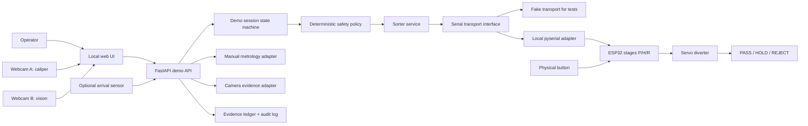
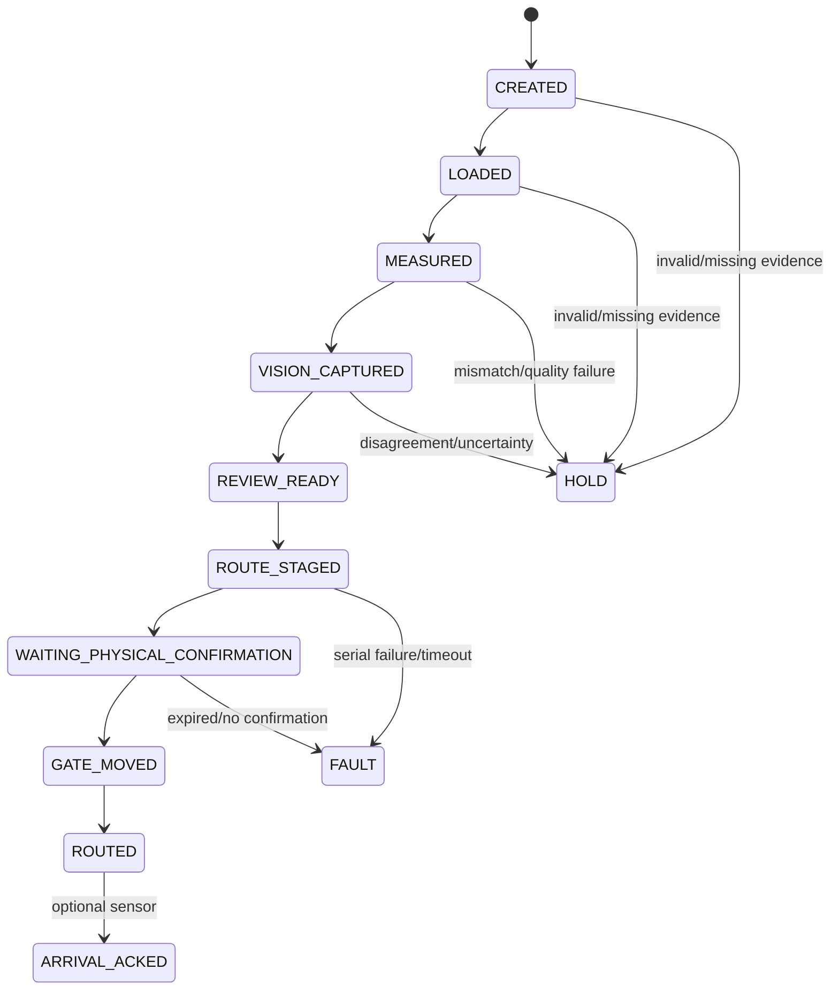

# Design: QualityRelay manual-track physical demonstration

## Architecture



The UI/API can be implemented and tested in Kiro Web. Webcam enumeration, local serial, firmware, and physical movement are verified only on the user's computer.

## Session state



HOLD is a review state, not a permanent failure. Explicit corrective actions may return a session to the last safe evidence-collection state. No automatic actuator retry is allowed.

## Core data models

### DemoSession

- `session_id: str`
- `specimen_id: str`
- `pair_ids: list[str]`
- `state: DemoState`
- `evidence_event_ids: list[str]`
- `decision: HOLD | PASS_REVIEW | CONFIRMED_REJECT | null`
- `hold_reasons: list[str]`
- `staged_action_id: str | null`
- `requested_bin: PASS | HOLD | REJECT | null`
- `actual_bin: PASS | HOLD | REJECT | null`
- `created_at`, `updated_at`

### ManualCaliperReading

- `event_id`, `session_id`, `specimen_id`
- `value_mm: float`
- `uncertainty_mm: float`
- `operator_id`, `instrument_id`, `calibration_id`
- `confirmed: bool`
- `camera_event_id: str | null`
- `ocr_candidate_mm: float | null`
- `measurement_location`, `notes`

### CameraCapture

- `event_id`, `session_id`, `specimen_id`
- `camera_id: CALIPER-CAM-A | VISION-CAM-B`
- `device_id_hash`
- `image_sha256`
- `observed_at`
- `width`, `height`
- `quality_usable: bool`
- `quality_reasons: list[str]`
- `method`, `candidate`, `calibrated: false`
- `source_event_ids`

### RouteAction

- `action_id`, `session_id`, `specimen_id`
- `requested_bin`
- `command: P | H | R`
- `operator_id`, `approved`
- `state: STAGED | SERIAL_SENT | WAITING_BUTTON | GATE_REPORTED | ACKED | FAULT`
- timestamps, `sensor_event_id`, `actual_bin`, `error`

## API behavior

Use the proposed `/demo/` namespace from `structure.md`. Every mutation validates the current state and appends an audit event. Responses include current state, allowed next actions, evidence coverage, and hold reasons.

Do not mutate the existing `/hardware/caliper-reading` placeholder into manual digital-caliper truth. Add a separate manual-metrology route/model.

Do not expose the raw serial adapter directly. `/route/stage` validates policy and stores an action before the sorter service writes a bounded command.

## Browser camera workflow

1. Request camera permission only after the user chooses camera setup.
2. Enumerate devices after permission.
3. Require two distinct device selections.
4. Open `CALIPER-CAM-A` and `VISION-CAM-B` independently.
5. Capture a still image to a canvas/blob only on explicit operator action.
6. Compute SHA-256 in the browser or backend and submit metadata plus image according to existing repository patterns.
7. Stop tracks when the operator leaves the session or changes devices.
8. Never start continuous recording automatically.

## Serial transport

Define a protocol/interface similar to:

```python
class SorterTransport(Protocol):
    def health(self) -> SorterHealth: ...
    def stage(self, command: Literal['P', 'H', 'R'], action_id: str) -> StageResult: ...
    def poll(self, action_id: str) -> SorterStatus: ...
```

Implementations:

- `FakeSorterTransport`: deterministic status and injected failures for tests.
- `SerialSorterTransport`: local `pyserial` connection configured by environment.

The existing one-character firmware cannot receive `action_id`; the backend retains correlation for the first milestone and accepts only one outstanding action. A later framed protocol may send/echo `action_id` before optional arrival acknowledgement is called end-to-end verified.

## Firmware behavior

- Start servo at configured HOLD angle.
- Accept only P/H/R.
- Stage without movement.
- Expire staged command after 15 seconds.
- Detect a new button press edge; ignore held/repeated input.
- Move once and clear pending state.
- Print machine-readable status lines in a future revision; preserve human-readable output until bridge parsing is implemented and tested.
- Clamp angles to an explicitly safe configured range.

## Persistence

- Use the existing ledger/persistence approach where practical.
- Store image files under a runtime directory, not Git.
- Persist content hashes and metadata in evidence/audit records.
- Enforce unique event IDs and action IDs at the storage layer.
- Record actual route separately from requested route.

## Failure handling

- Camera permission/device/capture failure: HOLD and recapture guidance.
- OCR mismatch: HOLD, display both values, require correction/new confirmation.
- Image digest duplication across camera roles: HOLD/shared source.
- Invalid state transition: 409 response with allowed transitions.
- Serial disabled/unavailable/write error: FAULT/HOLD; no implicit simulation unless the session is already marked TEST_FIXTURE.
- Button timeout: expired staged action; new action ID required.
- Wrong-bin ACK: route mismatch; no requested-bin count increment.
- Duplicate ACK: idempotent no-op with explicit status.

## Test strategy

### Automated

- State-machine transition matrix.
- Pydantic/API validation.
- Manual metrology confirmation and OCR mismatch.
- Distinct camera IDs and identical-image rejection.
- Deterministic HOLD/PASS_REVIEW/CONFIRMED_REJECT logic.
- Fake serial success, unavailable, timeout, malformed status, and duplicate action.
- Optional ACK correlation, mismatch, and idempotency.
- UI tests using fake media/transport where the repository supports them.
- Existing regression suite unchanged or intentionally updated.

### Manual local

- Two Logitech devices enumerate distinctly.
- Webcam A frames the caliper display.
- Webcam B repeats the specimen pose.
- ESP32 connects at 115200 baud.
- P/H/R stages without movement.
- Physical button moves once.
- Stage timeout prevents movement.
- Servo angles route into correct bins without hitting stops.
- Good, uncertain, and visual-anomaly demonstration runs are logged.

Manual checks remain unchecked until the user reports their results.
