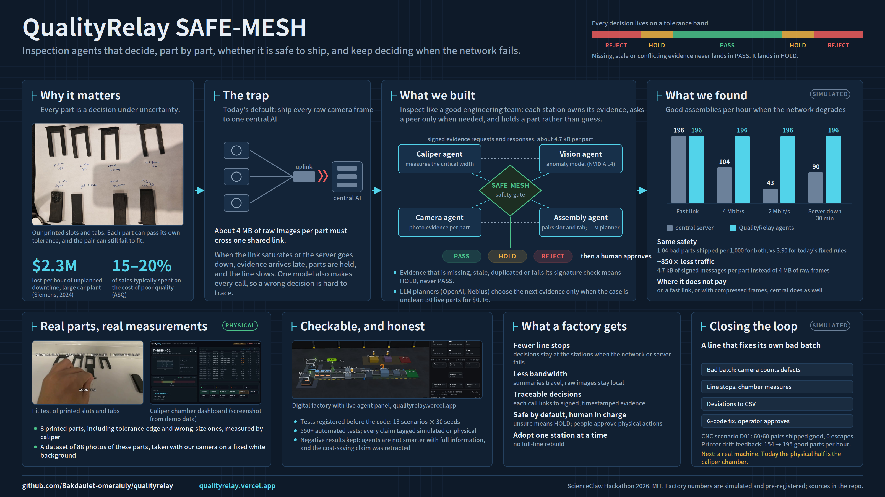
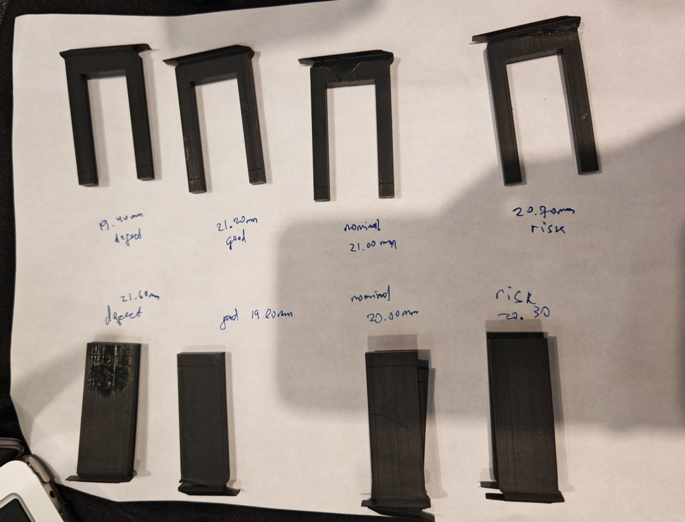
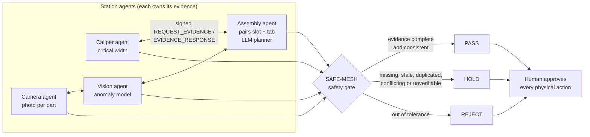
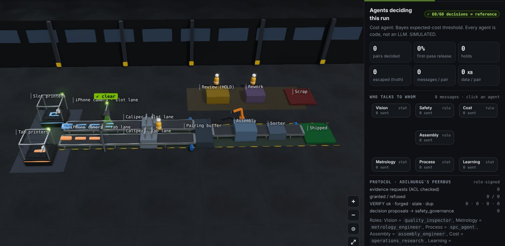
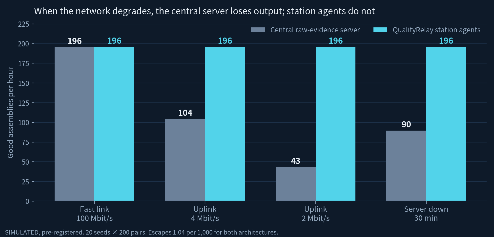
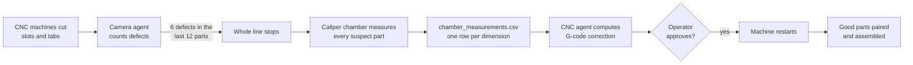
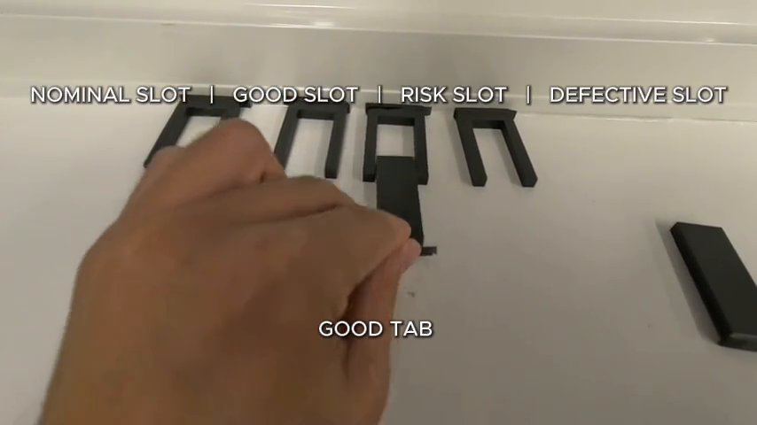
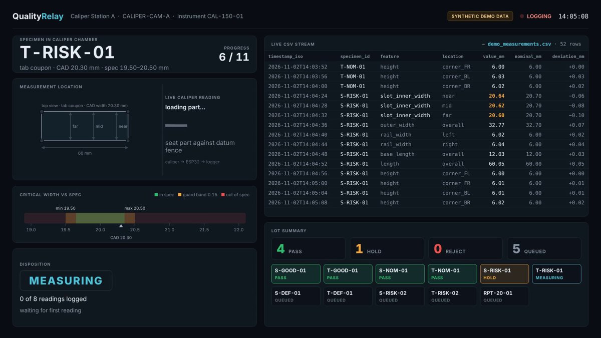

# QualityRelay SAFE-MESH

**Inspection agents that decide, part by part, whether a part is safe to ship, and keep deciding when the factory network fails.**

ScienceClaw Hackathon 2026 (MIT LAMM × E14 Fund) · Team QualityRelay

| | |
|---|---|
| 🌐 **Live demo** | [qualityrelay.vercel.app](https://qualityrelay.vercel.app) (digital factory, agent panel, CNC loop; all factory data `SIMULATED`) |
| 🎬 **Demo video** | _add link_ |
| 📊 **Slides** | _add link_ |
| 🧾 **Every claim and its evidence** | [CLAIMS_AND_OPEN_WORK.md](CLAIMS_AND_OPEN_WORK.md) |



---

## Contents

1. [Why this matters](#1-why-this-matters)
2. [The idea](#2-the-idea-inspect-like-a-good-engineering-team)
3. [What we built](#3-what-we-built)
4. [Key result: the line keeps running when the network does not](#4-key-result-the-line-keeps-running-when-the-network-does-not)
5. [Closing the loop: a line that fixes its own bad batch](#5-closing-the-loop-a-line-that-fixes-its-own-bad-batch)
6. [Real parts, real measurements](#6-real-parts-real-measurements)
7. [How we kept it honest](#7-how-we-kept-it-honest)
8. [What is real and what is simulated](#8-what-is-real-and-what-is-simulated)
9. [Run it yourself](#9-run-it-yourself)
10. [Repository map](#10-repository-map)
11. [Cross-team collaboration](#cross-team-collaboration)

---

## 1. Why this matters

Every part on a production line is a decision under uncertainty. Ship a bad part and it reaches a customer; hold a good one and you lose output.



Our test case is a slot and a tab that must fit together. **Each part can pass its own tolerance, and the pair can still fail to fit**, because the errors stack. Caliper, camera and CAD evidence about the same part also disagree regularly.

Getting these calls wrong is expensive:

- **$2.3M** lost per hour of unplanned downtime at a large automotive plant (Siemens, *True Cost of Downtime 2024*)
- **15–20%** of sales typically spent on the cost of poor quality (ASQ)

Factories are now adding AI to inspection. The default design sends every raw camera frame to **one central server** that decides for everyone. That works until the uplink saturates or the server goes down; then evidence arrives late, parts wait, and the line slows or stops.

<br clear="right"/>

## 2. The idea: inspect like a good engineering team

A good engineering team does not send every raw measurement to the boss. Each engineer owns their data, asks a colleague only when they need a second opinion, and says *"I'm not sure, hold this part"* instead of guessing.

QualityRelay works the same way:



Three rules make it safe:

1. **Evidence stays where it is produced.** Stations exchange small, role-signed messages (about 4.7 kB per part), not raw images (about 4 MB).
2. **Unsure means HOLD, never PASS.** Evidence that is missing, stale, duplicated (one photo counted twice) or fails its signature check sends the part to HOLD.
3. **A human approves every physical action.** Agents recommend; people sort and sign off.

## 3. What we built

| Component | What it does | Where |
|---|---|---|
| **Peer protocol** | Role-signed `REQUEST_EVIDENCE` / `EVIDENCE_RESPONSE` with access control, ownership and verification (signature, staleness, lineage); failed verification → HOLD | `qualityrelay17/`, [P1 results](docs/research/P1_DECENTRALISATION_RESULTS.md) |
| **SAFE-MESH safety gate** | Turns evidence into PASS / HOLD / REJECT; never PASSes on incomplete evidence | `qualityrelay17/` |
| **LLM planners** | OpenAI and Nebius models choose the next evidence only when a case is unclear; a live run of 30 parts cost **$0.156**; the website replays a recorded run for $0 | [LLM_PLANNERS.md](docs/engineering/LLM_PLANNERS.md) |
| **Digital factory** | Event-driven line with printers or CNC machines, cameras, caliper chamber, review station, assembly and sorter; live agent panel | [qualityrelay.vercel.app](https://qualityrelay.vercel.app) |
| **Anomaly model** | Trained on an NVIDIA L4 GPU: 0.948 image AUROC on the public MVTec `screw` benchmark; ready for our printed-part photos | [ANOMALY_GPU_RUN_31OCT.md](docs/research/ANOMALY_GPU_RUN_31OCT.md) |
| **Rare-event Monte Carlo** | NVIDIA Warp, for low-probability failure scenarios | [WARP_MC_AND_TUNING_31OCT.md](docs/research/WARP_MC_AND_TUNING_31OCT.md) |
| **Physical bench** | 3D-printed slots and tabs, caliper chamber with ESP32 logger, fit tests, labeled photos | [Section 6](#6-real-parts-real-measurements) |

<p align="center"><br><em>The digital factory at qualityrelay.vercel.app: every agent decision can be opened and inspected.</em></p>

## 4. Key result: the line keeps running when the network does not

We registered this test **before** writing the code ([registration](docs/research/P1_DECENTRALISATION_REGISTRATION.md)): our station agents against a central server that receives every raw frame, on the same simulated line, 20 seeds × 200 pairs.



| Network condition | Central server (good assemblies/h) | Station agents | Escapes per 1,000 (both) |
|---|---:|---:|---:|
| Fast link, 100 Mbit/s | 195.7 | 195.8 | 1.04 |
| Uplink 4 Mbit/s | **104.4** | 195.8 | 1.04 |
| Uplink 2 Mbit/s | **43.2** | 195.8 | 1.04 |
| Server down for 30 min | **89.7** | 195.8 | 1.04 |

- **Same safety.** Both architectures ship 1.04 bad parts per 1,000; today's fixed rules ship 3.90.
- **About 850× less network traffic.** 4.7 kB of signed messages per part instead of about 4 MB of raw frames.
- **Where it does not pay, and we say so.** On a fast link, both make *identical* decisions (360 runs, zero differences): decentralization is not smarter with full information. With compressed frames, the central server recovers. The advantage is real where bandwidth is limited or links fail.
- **Stated assumption:** the local network between stations stays up. We have not yet tested station-to-station failures.

📄 Full results: [P1_DECENTRALISATION_RESULTS.md](docs/research/P1_DECENTRALISATION_RESULTS.md) · data: [`examples/results/p1_decentralisation/`](examples/results/p1_decentralisation/)

**Also when a sensor drops out.** Against fixed rules in 15 simulated failure scenarios, the QualityRelay policy shipped fewer bad assemblies in all 15. It kept **95% more good output** when 15% of camera readings went missing and **56% more** when a camera was cut off by a network partition, because fixed rules hold everything while QualityRelay uses the evidence that is left. It kept throughput in only 4 of the 15 scenarios, and we report that too ([SIM_18_1_RESULTS.md](docs/research/SIM_18_1_RESULTS.md)).

## 5. Closing the loop: a line that fixes its own bad batch

Inspection is only half the job. In our CNC scenario **D01**, the whole first batch comes out wrong (a 1.6 mm tool-offset error), and the agents correct the machine:



- **Result (simulated):** seeds 0–2, 60 pairs: **0 escaped assemblies, 60/60 shipped good**. No blank is cut while the line is stopped. Try it on the [live demo](https://qualityrelay.vercel.app) (scenario D01). Details: [CNC_DEMO_SCENARIO_D01.md](docs/research/CNC_DEMO_SCENARIO_D01.md)
- **Under printer drift,** feeding inspection back to the printer raised good output from **154 to 195 parts per hour** and cut escapes from **4.96 to 2.59 per 1,000** ([INNOVATIONS_RESULTS_31OCT.md](docs/research/INNOVATIONS_RESULTS_31OCT.md)).
- No real CNC machine is controlled. The G-code is illustrative. The physical half of this loop today is our caliper chamber, below.

## 6. Real parts, real measurements

The simulation is only worth something if it connects to real parts. We printed and measured them.

<table>
<tr>
<td width="50%"><br><em>Fit test: nominal, good, risk and defective slots × tabs.</em></td>
<td width="50%"><br><em>Caliper chamber: each reading streams to a CSV row (screenshot from a demo run).</em></td>
</tr>
</table>

| Specimen | Design width | Role |
|---|---:|---|
| `S-GOOD` / `T-GOOD` | 21.20 / 19.80 mm | comfortable clearance |
| `S-NOM` / `T-NOM` | 21.00 / 20.00 mm | nominal |
| `S-RISK` / `T-RISK` | 20.70 / 20.30 mm | each in tolerance, pair at the edge |
| `S-DEF` / `T-DEF` | 19.40 / 21.60 mm | wrong size, must be rejected |

- **8 printed specimens**, CAD and STL in [`examples/cad/`](examples/cad/), print list in [print_manifest.csv](examples/cad/print_manifest.csv)
- **Caliper chamber:** caliper → ESP32 → CSV logger, firmware in [`firmware/measurement_station/`](firmware/measurement_station/), procedure in [MEASUREMENT_LOGGING.md](docs/engineering/MEASUREMENT_LOGGING.md)
- **Photo dataset: 88 photos** of the 8 printed specimens, taken with our camera on a fixed white background and named by specimen ID and defect type ([photos](tests/photos/), [capture guide](docs/engineering/PHOTO_CAPTURE_GUIDE.md))
- **Human-confirmed sorting:** the demo routes parts to PASS / HOLD / REJECT bins by hand; no actuator moves without a person ([PHYSICAL_DEMO_OVERVIEW.md](docs/engineering/PHYSICAL_DEMO_OVERVIEW.md))

These are tagged `PHYSICAL_CAPTURE`. They show the measurement pipeline on real parts; they do not validate the factory-scale numbers above.

## 7. How we kept it honest

- **Pre-registered.** Scenarios, metrics and decision rules were written down before running: [protocol registration](docs/research/PROTOCOL_REGISTRATION_31OCT.md) (13 scenarios × 30 seeds × 1,000 parts) and [P1 registration](docs/research/P1_DECENTRALISATION_REGISTRATION.md).
- **Negative results kept.** Our first reference policy was *not* better than conservative rules ([protocol results](docs/research/PROTOCOL_RUN_31OCT_RESULTS.md)); majority voting among agents was unsafe (21.7 unsafe passes per 1,000); with full information, decentralization adds messages, not insight ([Gate A](docs/research/COLLECTIVE_GATE_A_RESULTS_31OCT.md)); an earlier cost-saving claim was **withdrawn** after we found unpriced messages.
- **Every claim tagged** `SIMULATED`, `PHYSICAL_CAPTURE` or `EXTERNAL_DATASET`, listed in [CLAIMS_AND_OPEN_WORK.md](CLAIMS_AND_OPEN_WORK.md).
- **550+ automated tests**, including prompt-injection tests for the LLM planners.

## 8. What is real and what is simulated

| Component | Status |
|---|---|
| Peer protocol, safety gate, digital factory, website | ✅ Built and running |
| LLM planners (OpenAI, Nebius) | ✅ Live runs; website replays a cached run |
| Network, failure and CNC-loop results | 🧪 `SIMULATED`, pre-registered |
| Anomaly model | 🧪 Trained on a public dataset (`EXTERNAL_DATASET`); 88 printed-part photos collected |
| Printed parts, caliper chamber, fit tests, 88-photo dataset | 🔩 `PHYSICAL_CAPTURE` |
| Real CNC control, factory deployment, station-to-station link failures | ⏳ Not done yet |

## 9. Run it yourself

```bash
python -m pip install -r requirements-demo.txt
python -m pytest -q                                   # run the test suite
uvicorn qualityrelay17.api:app --host 127.0.0.1 --port 8000
# open http://127.0.0.1:8000
```

Or open the [live demo](https://qualityrelay.vercel.app). Photo capture and photo measurement need a local run.

## 10. Repository map

| Path | What is inside |
|---|---|
| [`qualityrelay17/`](qualityrelay17/) | Agents, peer protocol, safety gate, simulation engine, API |
| [`web/`](web/) | The Studio website (digital factory, 3D Lab, agent panel) |
| [`docs/research/`](docs/research/) | Registrations, results, references |
| [`docs/engineering/`](docs/engineering/) | Physical bench, measurement, LLM planners, team handoffs |
| [`examples/results/`](examples/results/) | Raw result files for every experiment |
| [`examples/cad/`](examples/cad/) | Specimen and sorter CAD/STL |
| [`firmware/`](firmware/) | ESP32 measurement station and sorter |
| [`tests/`](tests/) | Test suite |
| [README_START_HERE.md](README_START_HERE.md) | Full engineering notes |

## Cross-team collaboration

We worked with two other ScienceClaw teams:

- **SentiLab.** Through a ScienceClaw collaboration ticket (3b5fc17f), aneta-claude (SentiLab) wrote a tolerance and fit check for our slot and tab specs. We run it as a separate service, keep the contributed code byte-for-byte with a hash check, and call it from QualityRelay; if the service is unreachable, the part goes to HOLD. We ran it on our physical caliper readings. [Details](collab/sentilab-tolerance-check/README.md)
- **CoFrom.** _Describe what CoFrom and QualityRelay did together._

## Built with

NVIDIA (L4 GPU training for the anomaly model; Warp for rare-event Monte Carlo) · OpenAI and Nebius (LLM planners) · Vercel (live demo) · 3D printing for the physical specimens

**Team:** Bakdaulet · adilnurgg · HyorinmaruK · Shuyan · Vinayak

---

*All factory-scale numbers are simulated and pre-registered. Industry figures are cited from their sources; see `docs/research/` for references.*
