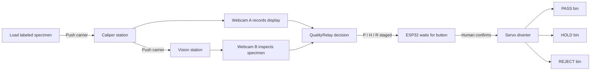

# QualityRelay manual-track demonstration build guide

This guide replaces the earlier coupon-only test layout with the physical manufacturing line described in the pasted ScienceClaw plan.

## 1. Build this version first

Build a **60–80 cm manually advanced track with a removable carrier**:

`LOAD → CALIPER → CAMERA INSPECTION → DECISION → SERVO DIVERTER → PASS/HOLD/REJECT`

You push the carrier between stations. One ESP32 controls only the final servo diverter. This avoids the rollers, belt, motor driver, tensioner, presence sensors, and separate motor-control states required by a powered conveyor.

Use the two Logitech webcams as follows:

- **Webcam A at the caliper station:** points at the digital-caliper display. OCR may suggest the number, but the operator confirms it.
- **Webcam B at the visual station:** fixed top/oblique view of the specimen for reference/CAD comparison and visible-defect detection.

The caliper remains manual. Do not attach a servo to its jaws.

## 2. What the demonstration proves

One labeled specimen moves through a visible process:

1. The operator loads it in a carrier.
2. The operator stops and measures it with a digital caliper.
3. Webcam A records the display.
4. The operator advances it to Webcam B for visual inspection.
5. QualityRelay produces or displays PASS, HOLD, or REJECT.
6. The command is staged; a person confirms it with a physical button.
7. The ESP32 moves the servo diverter.
8. The operator advances/releases the specimen into the selected bin.
9. An optional independent LDR/4N35 sensor confirms physical arrival.

The manual carrier is the transport. The servo automates only the final routing gate.

## 3. Complete equipment list

### Mechanical line

| Qty | Item | Recommended size/use |
|---:|---|---|
| 1 | Baseboard | Approximately 800 × 250 mm plywood, MDF, foam board, or rigid cardboard |
| 2 | Straight side rails | 700–800 mm long and 10–20 mm high |
| 1 | Removable carrier | Approximately 75 × 45 mm; fits the 60 mm coupons |
| 4 | Station stops or marks | Load, caliper, vision, and sorter positions |
| 1 | Caliper registration fixture | Two small blocks or taped marks that repeat the part position |
| 2 | Webcam stands/clamps | Keep both camera views fixed |
| 1 | Lightweight diverter flap | About 50 × 40 mm plastic, card, plywood, or printed part |
| 1 | Servo mounting bracket | Kit bracket, printed bracket, or rigid blocks |
| 3 | Collection bins/trays | PASS on left, HOLD in center, REJECT on right |
| 1 set | Fasteners | Hot glue, double-sided tape, screws, zip ties, and/or hook-and-loop tape |
| 1 | Dark matte background sheet | Under Webcam B for contrast with white PLA |

The archived coupons are 60 mm long, no more than 33.2 mm wide, and 6 mm high. A 75 × 45 mm carrier gives practical clearance. Set the track clear width to the measured carrier width plus about 2–3 mm so it slides without rotating.

### Inspection equipment

| Qty | Item |
|---:|---|
| 1 | Digital caliper |
| 2 | Logitech USB webcams |
| 1 | Computer running the local dashboard/camera software |
| 1 | Powered USB hub with at least three data ports, unless the computer already has enough ports |
| 2 | Diffuse lights or one lightbox |
| 1 set | Black specimen labels and marker |
| 1 | Measurement/results spreadsheet or CSV log |

The two webcams plus the ESP32 USB connection require three computer data ports. A powered hub also prevents marginal webcam power from causing disconnects.

### Servo sorter electronics

| Qty | Item | Notes |
|---:|---|---|
| 1 | ESP32 development board | One board is enough for the servo sorter |
| 1 | Small 3-wire servo | Use the servo from the ELEGOO kit if available; SG90/MG90-size is sufficient for a light flap |
| 1 | Regulated servo supply | Match the voltage printed on the servo; for a common 5 V micro servo, use a 5 V supply rated at least 1 A, preferably 2 A |
| 1 | USB data cable | Computer to ESP32 |
| 1 | Momentary pushbutton | Human authorization before movement |
| 1 | Breadboard | Wiring |
| 1 set | Jumper wires | Male/male and the connector style needed by the servo |
| 1 | 470–1000 µF electrolytic capacitor | Across servo supply near the servo; observe polarity |

You do **not** need a motor driver for a normal hobby servo. The ESP32 provides only the control signal; the external supply provides servo power.

### Optional independent arrival confirmation

| Qty | Item |
|---:|---|
| 1 per instrumented bin | Photoresistor/LDR |
| 1 per instrumented bin | 4N35 optocoupler |
| 1 per channel | Approximately 1 kΩ sensing-loop resistor |
| 1 per channel | Approximately 10 kΩ ESP32 pull-up resistor |
| 1 | Second ESP32, recommended for genuine independence |
| 1 | Separate low-voltage sensor-loop supply |

Start without this. Add it after the carrier, cameras, measurement, and servo gate work reliably.

### Print list

Print the nine-piece robust set from `examples/cad/stl/`:

- `slot_good_21p20.stl` ×1
- `slot_nominal_21p00.stl` ×1
- `slot_risk_20p70.stl` ×2
- `tab_good_19p80.stl` ×1
- `tab_nominal_20p00.stl` ×1
- `tab_risk_20p30.stl` ×2
- `repeatability_bar_20p00.stl` ×1

You only need three representative specimens for the live line: one comfortable/good example, one near-boundary example, and one clearly marked visual-anomaly example. Keep the remaining prints as references and backups.

## 4. Recommended station layout

Use an 800 mm baseboard and mark station centers approximately as follows:

| Position from start | Station | What happens |
|---:|---|---|
| 80 mm | Load | Put the labeled specimen in the carrier |
| 250 mm | Caliper | Stop, lift/locate the specimen, measure it, return it in the same orientation |
| 450 mm | Vision | Webcam B records the fixed inspection view |
| 600 mm | Decision/authorization | Show PASS/HOLD/REJECT; stage the matching servo position |
| 700 mm | Diverter | Press the physical confirmation button, move gate, and advance the part into its bin |

The exact spacing can change to match the available table and camera focal distance. Keep the order and provide a repeatable physical stop at the caliper and vision stations.

## 5. Build the mechanical line

### Step 1 — make the carrier

1. Cut or print a 75 × 45 mm flat carrier.
2. Add a shallow 3–5 mm lip on three sides so the specimen does not fall off.
3. Leave the front open so the specimen can slide or be removed easily.
4. Mark one orientation arrow and one carrier ID.
5. Verify that all slot and tab specimens sit flat without rocking.

### Step 2 — make the track

1. Place the carrier on the baseboard.
2. Position two straight rails around it with 2–3 mm total lateral clearance.
3. Move the carrier through the full length by hand.
4. Adjust until it does not jam, rotate, or lift.
5. Fix the rails with tape/screws/glue only after the motion is reliable.
6. Add a raised stop or visible line at each station position.

### Step 3 — make the caliper station

1. At the 250 mm mark, add two small registration blocks or tape outlines for repeatable part placement.
2. Mount Webcam A so the caliper display fills most of the image without glare.
3. Keep access clear for the operator's hands and caliper jaws.
4. Measure manually; do not motorize the caliper.
5. If OCR is used, show the OCR result as a candidate and require the operator to confirm the displayed number.

### Step 4 — make the vision station

1. Put a dark matte pad at the 450 mm mark.
2. Mount Webcam B directly above or at a fixed oblique angle.
3. Add diffuse lighting from both sides.
4. Mark the carrier stop so every specimen appears at the same scale and orientation.
5. Capture a reference image from this exact fixture before testing other parts.

### Step 5 — make the diverter

1. Arrange PASS, HOLD, and REJECT bins left-to-right after the end of the track.
2. Mount the servo under or beside the track end.
3. Attach the lightweight flap to the servo horn.
4. The flap should sweep across the exit without touching the carrier.
5. Begin with the servo centered at 90° for HOLD.
6. Test left and right positions in 5° increments. Do not force the servo against a mechanical stop.
7. Typical starting angles are PASS 35°, HOLD 90°, and REJECT 145°, but calibrate them to the real gate.

## 6. Exact ESP32 connections

The example firmware uses GPIO 13 for the servo signal and GPIO 32 for the confirmation button. Verify that both pins are exposed and suitable on the exact ESP32 board; change the constants if using a different ESP32-S3 pinout.

### Servo and button wiring

| From | Connect to | Purpose |
|---|---|---|
| Servo signal wire, usually orange/yellow | ESP32 GPIO 13 | PWM position command |
| Servo positive wire, usually red | External regulated servo-supply positive | Servo power |
| Servo ground wire, usually brown/black | External servo-supply ground | Servo return |
| External servo-supply ground | ESP32 GND | Common reference for the control signal |
| Confirmation button leg 1 | ESP32 GPIO 32 | Human authorization input |
| Confirmation button leg 2 | ESP32 GND | Firmware uses `INPUT_PULLUP` |
| Capacitor positive | Servo-supply positive | Reduces voltage dips |
| Capacitor negative | Servo-supply ground | Observe electrolytic polarity |
| ESP32 USB | Computer or powered USB hub | Programming, serial commands, and ESP32 power |

Critical rules:

- Do not connect servo power to an ESP32 GPIO pin.
- Do not power the servo from the ESP32 3.3 V pin.
- Join only the grounds needed for the servo control reference.
- Disconnect power before changing wiring.
- Start without the flap attached and confirm the angles first.

## 7. Upload and test the servo firmware

Use the supplied `esp32_manual_sorter.ino` prototype.

1. Install the ESP32 board support in Arduino IDE if it is not already present.
2. Install the `ESP32Servo` library used by the sketch.
3. Select the exact ESP32 board and USB port.
4. Keep the servo horn/flap disconnected for the first upload.
5. Upload the sketch.
6. Open Serial Monitor at 115200 baud.
7. Enter `P`, `H`, or `R`. The sketch stages the requested route but does not move yet.
8. Press the physical button. The servo moves only after this confirmation.
9. Verify all three angles, then power off and attach the flap at the centered HOLD position.
10. Repeat the position test and change the three angle constants if needed.

This is a human-confirmed prototype. The archive does not currently connect its web decision API to servo GPIO. Later, a local serial bridge can send `P`, `H`, or `R` after the dashboard stages a decision, while the button remains the final authorization.

## 8. Connect the cameras and software

1. Connect Webcam A and Webcam B to separate ports on the powered USB hub/computer.
2. Connect the ESP32 USB cable as the third data device.
3. Assign stable names in the run log: `CALIPER-CAM-A` and `VISION-CAM-B`.
4. Verify that the camera software opens both devices separately.
5. Lock or record resolution, focus, exposure, station position, and lighting where possible.
6. Save original images with specimen ID, camera ID, timestamp, and capture number.
7. At the caliper station, manually confirm the number visible on the display.
8. At the vision station, compare the captured image with that station's own reference image.
9. Missing, blurred, badly lit, or inconsistent evidence must produce HOLD—not PASS.

## 9. Run the three main demonstration cases

### Run A — comfortable/good specimen

1. Place the labeled good specimen in the carrier.
2. Push to the caliper stop.
3. Measure three times and record every reading.
4. Let Webcam A capture the display; confirm the number manually.
5. Return the specimen to the same carrier orientation.
6. Push to the vision station and capture Webcam B.
7. Perform the manual fit check if demonstrating a slot/tab pair.
8. Stage PASS by sending `P` to the ESP32.
9. Move the carrier to the diverter, press the confirmation button, and advance the specimen into PASS.
10. Record actual bin and any arrival-sensor event.

### Run B — tight or uncertain specimen

1. Repeat the same sequence with the measured risk pair/specimen.
2. Show that the local dimensions may appear plausible while the pair clearance/fit is uncertain.
3. Stage `H`, physically confirm, and route to HOLD.
4. Explain that HOLD requests more inspection; it is not a false automatic rejection.

### Run C — visible anomaly

1. Use a separately labeled specimen with a documented visible defect or a clearly disclosed visual-anomaly test marker.
2. Repeat the caliper measurement; it may still be dimensionally acceptable.
3. Capture the visual anomaly under Webcam B.
4. Stage `R` only if a human has confirmed the nonconformance; otherwise use HOLD.
5. Confirm with the button and route to the selected bin.

Do not describe a removable sticker or artificial mark as a real manufacturing defect. Call it an anomaly-detection fixture.

## 10. Failure demonstrations after the main line works

Run these only after Runs A–C are reliable:

- Disconnect Webcam B: the decision must default to HOLD.
- Blur or cover Webcam B: request recapture/HOLD.
- Reuse the same image as two sources: do not count it as independent evidence.
- Stage PASS, then manually place the specimen in HOLD: the optional arrival sensor should expose the mismatch after the missing `action_id` integration is implemented.
- Replay one route acknowledgement: it must not increment the count twice after idempotency is connected.

## 11. What remains manual or incomplete

- The carrier movement is manual by design.
- Caliper placement and confirmation are manual.
- The included prototype uses Serial Monitor to stage P/H/R.
- A person presses the final authorization button.
- The current QualityRelay archive has no live servo endpoint or dashboard-to-serial bridge.
- The current bin-ACK endpoint has no `action_id` and is not connected to `SorterInterlock.acknowledge()`.
- The optional arrival sensor should not be presented as end-to-end verified until those two software gaps are fixed.

This scope is still a real physical manufacturing-line demonstration: the specimen physically moves through distinct stations, produces measurement and vision evidence, receives a governed decision, and is routed by an ESP32-controlled gate after human authorization.

## 12. Upgrade to a powered conveyor later

Only replace manual movement after the full line works. The powered version additionally needs:

- DC geared motor.
- Compatible motor driver such as a DRV8833.
- Motor supply matched to the motor/driver.
- Two rollers, shafts, bearings, brackets, belt, and tensioner.
- Emergency/stop switch.
- Presence sensors at the caliper and vision stations.
- Software states for run, stop, timeout, jam, retry, and safe restart.

The servo still controls only the final diverter. The motor driver controls the conveyor motor; never connect a DC motor directly to an ESP32 pin.
